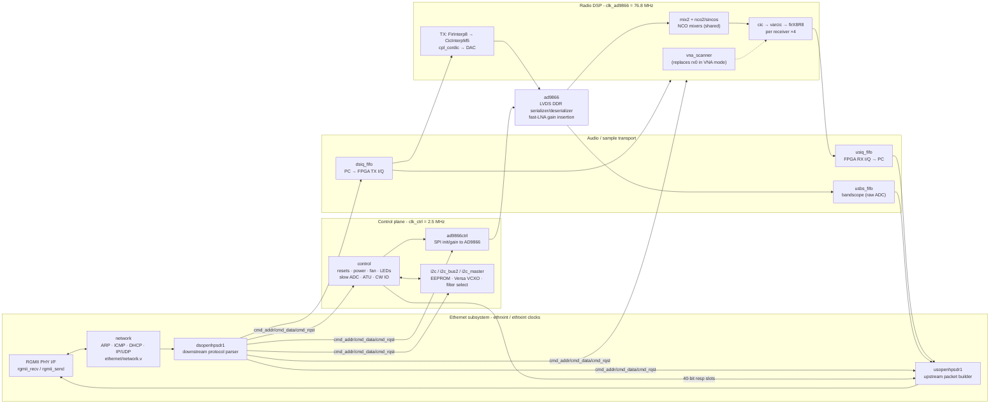
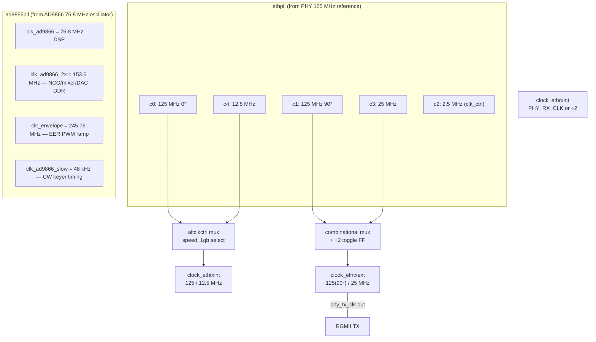
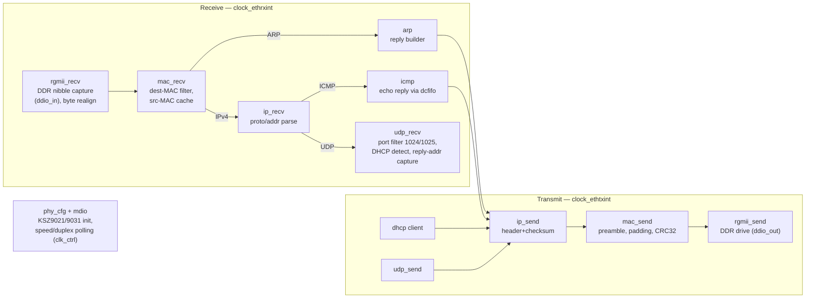
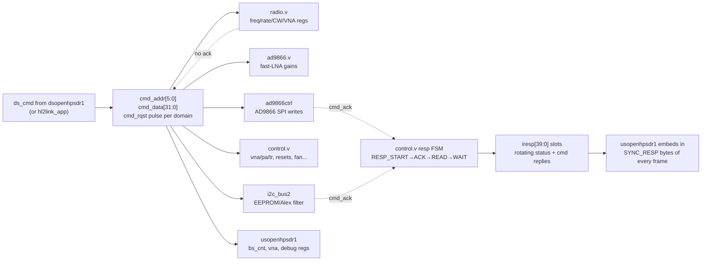
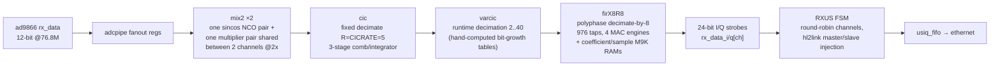
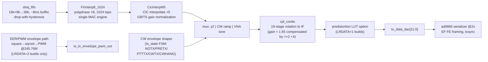

# Hermes-Lite 2 Gateware Architecture

This document describes the high-level architecture of the Hermes-Lite 2 FPGA gateware,
focused on the `hl2b5up_main` build variant (HL2 board revision 5 and later, main
configuration). All file references are relative to `gateware/`.

*Companion pages: [Critical Bugs](Critical-Bugs) · [Refactor Plan](Refactor-Plan)*

---

## 1. System Overview

The Hermes-Lite 2 is a direct-sampling amateur radio SDR transceiver built around:

| Component | Device | Role |
|---|---|---|
| Intel/Altera Cyclone IV `EP4CE22E22C8` | 22,320 LEs, 60 M9K, 52 × 18×18 multipliers | The entire digital radio |
| AD9866 | ADC/DAC combo, 76.8 MHz | 12-bit RX ADC and TX DAC with fast LNA gain control |
| Ethernet PHY (KSZ9021/9031 class) | RGMII, 1 Gb/s or 100 Mb/s | All host I/O |

There is **no CPU in the design** — it is pure RTL. Everything the radio does is driven
by a PC over UDP using the OpenHPSDR *Metis*-derived protocol (discovery, streaming
I/Q samples, embedded command/response slots), extended by Hermes-specific fields.

The top level (`variants/hl2b5up_main/hermeslite.v`) is a thin pin wrapper that
instantiates `rtl/hermeslite_core.v` with these parameters:

```verilog
BOARD=5, NR=4 (receivers), NT=1 (transmitter),
UART=1 (HR50 amp announcer), ATU=1 (JI1UDD tuner), FAN=1, PSSYNC=1,
CW=1, ASMII=1 (flash programming), HL2LINK=1 (inter-board link),
FAST_LNA=1, EXTENDED_RESP=1, EXTENDED_DEBUG_RESP=1
```

### 1.1 Top-Level Block Diagram



---

## 2. Source Tree and Build Configuration

```
gateware/
├── rtl/
│   ├── hermeslite_core.v      # top integration, CDC mesh, clocking
│   ├── ad9866.v               # LVDS sample I/O + fast LNA
│   ├── ad9866pll.v, ethpll.v  # generated PLL wrappers
│   ├── usopenhpsdr1.v         # upstream (card→PC) protocol packer
│   ├── dsopenhpsdr1.v         # downstream (PC→card) protocol parser
│   ├── control.v              # board control plane
│   ├── fifos.v                # all cross-domain sample FIFOs
│   ├── sync.v, cdc_sync.v     # CDC primitives
│   ├── ethernet/              # full UDP/IP stack (Metis lineage)
│   ├── nco/                   # NCO ROMs and mixers
│   ├── radio_openhpsdr1/      # DSP chains: CIC, CORDIC, FIR, VNA
│   ├── cw_*.v, iambic.v       # CW keyers
│   ├── i2c*.v, slow_adc.v     # board management
│   ├── hl2link*.v             # inter-board sync link
│   ├── asmi_*.v, remote_update.v  # firmware self-programming
│   └── radioberry/, localaudio/, primitives/   # other boards/options
├── variants/hl2b5up_main/     # this variant: .qsf/.qpf, Makefile, top wrapper
└── boards/hl2b5up/            # pins.tcl, timing.sdc, files.tcl (source list)
```

Notes on the build:

* `variants/hl2b5up_main/hermeslite.qsf` sets Verilog macros `BETA5=1`
  (board rev ≥5 behaviour) and `USE_ALTSYNCRAM=1` (infer M9K RAMs).
* `boards/hl2b5up/files.tcl` lists every compiled source. It contains duplicate
  entries and pulls in files never instantiated for this variant (the QS1R receiver
  set, `receiver.v`, `receiver_4000.v`, …); Quartus elaborates them but prunes
  unused modules. See [Refactor-Plan](Refactor-Plan) §R5.
* Simulation lives in `gateware/sim/` as MyHDL co-simulation testbenches
  (`test_rx2.py`, `test_nco1.py`, `test_mix1.py`, `test_cordic.py`, …) run under
  Icarus Verilog.

---

## 3. Clocking and Reset Architecture

The design is explicitly multi-clock. There are two PLLs and several derived clocks;
nearly every inter-block connection crosses a domain and uses one of these
mechanisms:

* The CDC toolkit in `rtl/sync.v`: `sync` (level), `sync_pulse` (edge→pulse),
  `sync_one` (rise→pulse), `sync_qualifier` (multi-bit bus captured under a
  synced valid toggle) and `sync_handshake` (four-phase pulse transfer).
* Quasi-static buses — command/data words that are guaranteed stable long
  before their strobe arrives, or slow telemetry/status. Every remaining raw
  crossing carries a `// QUASI_STATIC_CDC:` annotation for grep-ability.
* Altera `dcfifo`/`dcfifo_mixed_widths` async FIFOs through the shared
  `stream_fifo` shell (`rtl/fifos.v`).

### 3.1 Clock Tree



| Clock | Domain owner | Contents |
|---|---|---|
| `clock_ethrxint` | Receive path | RGMII capture, MAC/IP/UDP parse, `dsopenhpsdr1`, write side of `dsiq_fifo`/`dslr_fifo`/`asmi_fifo` |
| `clock_ethtxint` | Transmit path | `mac_send`…`rgmii_send`, `usopenhpsdr1`, read side of upstream FIFOs |
| `clk_ctrl` (2.5 MHz) | Slow control | `control.v`, network state machine, DHCP timers, MDIO, I²C master, slow ADC |
| `clk_ad9866` (76.8 MHz) | DSP | `radio.v`, receivers, TX chain, `ad9866` core logic |
| `clk_ad9866_2x` (153.6 MHz) | Fast DSP | Dual-channel NCO/mixers, FIR MAC engines, DAC/LVDS serialization |
| `clk_envelope` (245.76 MHz) | EER only | Envelope PWM ramp counter (LRDATA=2 builds only; off in this variant) |
| `clk_ad9866_slow` (48 kHz) | Keyer | `iambic.v` element timing |

The 100 Mb/s mode reuses divided clocks instead of reprogramming the PLLs:
`clock_ethtxint` muxes to 12.5 MHz, `clock_ethtxext` to 25 MHz, and the receive clock
is produced by a toggle flop on `phy_rx_clk` selected through a combinational mux
(`hermeslite_core.v:395-399`). Speed selection is latched at link-up
(`network.v:154`) while the link is down, which is what makes the glitchy muxes
tolerable.

### 3.2 Reset Distribution

`control.v` derives a staggered power-on reset from a free-running counter once
`ethup = ethpll_locked & phy_rst_n` is true (`control.v:187-205`):

| Offset | Signal | Purpose |
|---|---|---|
| ~410 µs | `clk_i2c_rst` | release I²C block |
| ~820 µs | `clk_i2c_start` | begin EEPROM/Versa init sequences |
| ~6.5 ms | `slow_adc_rst` | release ADS7828 poller |
| ~13 ms | `rffe_ad9866_rst_n` | release AD9866 hardware reset |
| ~26 ms | `ad9866_rst` deasserted | AD9866 SPI init starts after PLL lock (`ad9866up`) |

Most other blocks rely on register initializers (FPGA-only assumption) plus targeted
resets: `rst_all`/`rst_nco` come from the hl2link app layer, and `hl2link_rst_req`
fires when the AD9866 clock is measured missing (`control.v:315-339`).

---

## 4. Ethernet Subsystem (`rtl/ethernet/`)

A compact, dependency-free UDP/IP stack inherited from OpenHPSDR Metis code and
extended since (DHCP renewal, KSZ9021 support, 1025-port operation):



Key behaviours:

* **Address resolution** — a single-entry remote MAC/IP cache (`mac_recv`,
  `ip_recv`) captures whoever spoke last; ARP replies and ICMP replies are sent to
  that cached entry.
* **Port model** — downstream SDR packets are accepted on UDP ports 1024/1025
  (`to_port[15:1] == 512`); port parity selects "alt" command responses. Broadcast
  frames are accepted when running; unicast requires matching `local_ip`.
* **IP acquisition** — static IP from EEPROM config, else DHCP with 1/3/7 s retries,
  APIPA fallback (169.254.x.x from MAC), then lease-renewal at half-life without
  disturbing the data path (`network.v:183-282`).
* **Speed handling** — MDIO polls vendor register 0x1F; `speed_1gb` switches the
  clock muxes described above and the RGMII capture realignment.

---

## 5. Protocol Layer

### 5.1 Downstream — PC → Radio (`dsopenhpsdr1.v`)

Runs in `clock_ethrxint`. Parses each UDP payload byte-by-byte:

```mermaid
stateDiagram-v2
    [*] --> START: wait 0xEF
    START --> PREAMBLE: EF seen
    PREAMBLE --> DECODE: FE seen
    DECODE --> ENDPOINT: 0x01 (SDR data)
    DECODE --> RUNSTOP: 0x04 (run/widespec)
    DECODE --> DISCOVERY: 0x02
    DECODE --> ASMI_DECODE: 0x03 (flash update)
    DECODE --> SYNC0: 0x05 (port 1025 sync)
    ENDPOINT --> SEQNO3 --> SEQNO2 --> SEQNO1 --> SEQNO0 --> SYNC2
    SYNC2 --> SYNC1 --> SYNC0: 7F 7F Cx
    SYNC0 --> CMDCTRL: C0 = resp_req·addr·PTT
    CMDCTRL --> CMDDATA3 --> CMDDATA2 --> CMDDATA1 --> CMDDATA0
    CMDDATA0 --> PUSHL1: 4×cmd_data done (port 1024)
    CMDDATA0 --> START: alt command (port 1025)
    PUSHL1 --> PUSHL0 --> PUSHR1 --> PUSHR0: audio L/R
    PUSHR0 --> PUSHI1
    PUSHI1 --> PUSHI0 --> PUSHQ1 --> PUSHQ0: TX I/Q + key bits
    PUSHQ0 --> PUSHL1: next group (≤63)
    PUSHQ0 --> SYNC2: group count exhausted
```

Outputs:

* `{dsethiq_tdata,tuser,tlast,tvalid}` — TX I/Q into the `dsiq_fifo`
  (9-bit lanes: 8 data bits + 1 user bit per channel, packed 36-bit wide).
* `ds_cmd_*` — one command slot per packet (6-bit address, 32-bit data,
  response-request flag, alt flag, PTT bit), announced by a toggling `ds_cmd_cnt`.
* `run`, `wide_spectrum` — global stream enables.
* Watchdog: if `run` and no valid packet start within ~4096 ms-ticks, everything is
  forced stopped (`dsopenhpsdr1.v:391-424`). RUNSTOP bit 7 can disable the watchdog.
* ASMI mode streams raw firmware bytes to the flash programmer.

### 5.2 Upstream — Radio → PC (`usopenhpsdr1.v`)

Runs in `clock_ethtxint`. Builds three packet types, always ≤1032 bytes:

1. **Discovery reply** (~60 bytes) — MAC, firmware version (74.2 for BOARD≠2),
   board ID, NR, supported features, static IP, alt MAC, and (EXTENDED_RESP)
   telemetry snapshot: temperature, fwd/rev power, bias, `dsiq_status`, packet
   counters, keyer state.
2. **SDR data frame** (port 512/513) — `EF FE 01 <endpoint> <seq32>` then rounds of
   per-receiver I/Q (24-bit I, 24-bit Q per channel), mic/user bytes, then a
   5-byte command-response slot (`0x7F 0x7F 0x7F` + 40-bit `resp` from
   `control.v`). Frames are only started when `usiq_fifo` holds >333 words so a
   full frame can be emitted without underrun.
3. **Bandscope/wideband frame** — raw 12-bit ADC samples from `usbs_fifo` (ep4
   sequence numbering), used for the wideband spectrum display.

Sequence numbers synchronize to FIFO activity (`ep4_seq_no[1:0]` held at 0 while
idle) because some host software depends on it.

### 5.3 Command/Response Bus

A single broadcast bus connects every command slave. It is a **pulse + stable-data**
protocol: the source registers `cmd_addr/cmd_data` in `clock_ethrxint`, a
`sync_pulse` carries the `cnt` toggle to each destination domain, and each slave
samples the data several cycles later (safe because commands arrive milliseconds
apart):



Address map highlights: `0x00` rate/receivers/duplex, `0x01–0x08`,`0x12–0x16` RX
frequencies, `0x01` also TX frequency, `0x09` VNA/PA/TR flags, `0x0a` RX gain /
PureSignal, `0x10` CW hang, `0x11` PWM min/max, `0x17` latency/PTT hang, `0x2b`
predistortion, `0x39` debug/synced receivers/watchdog control, `0x3a` reboot,
`0x3b` generic AD9866 SPI write.

---

## 6. Radio DSP (`rtl/radio_openhpsdr1/`, `rtl/nco/`)

All DSP runs in `clk_ad9866`; heavy arithmetic is time-multiplexed onto
`clk_ad9866_2x`.

### 6.1 Receive Chain (×NR, NR=4 here)



* **NCO** (`nco2.v` + `sincos.v`): dual ping-pong 32-bit phase accumulators at 2×
  clock; sine/cosine from coarse 256×36 ROM quarter-folded + fine correction
  (CALCTYPE=3 → LE-multiplier fine terms rather than another ROM — a deliberate
  M9K-for-LE trade on this small device).
* **Frequency setup**: the PC sends a 32-bit frequency; `radio.v` computes
  `phase_inc = f·2^57/76.8e6` (multiply constant `M2`) and distributes phases to
  channel accumulators through a 3-cycle `CMD_FREQ*` pipeline. In non-duplex
  single-receiver mode RX0 automatically tracks the TX frequency.
* **PureSignal (predistortion feedback)**: when enabled, mixer channel 1 is fed
  `tx_data_dac` instead of the ADC, producing a basebanded feedback of the actual
  transmitted signal for the PC's adaptive algorithm (`radio.v:510-524`).
* **VNA mode**: `vna_scanner` replaces receiver 0, sweeping `tx_freq` in steps and
  averaging 1024 samples per point; the TX CORDIC is driven at fixed amplitude.
* **Rates**: 76.8 MHz /(5 × {40,20,10,5} × 8) = 48/96/192/384 ksps, selected live.

### 6.2 Transmit Chain



Gain distribution through the TX chain is documented in the comment block at
`radio.v:847-881`: CIC loss 0.61 × CORDIC 1.65 × ¼ × 4 ≈ 1.0 into the 12-bit DAC.

**CW keying** is fully internal: the `tx_state` machine shapes a linear ramp
(`tx_cwlevel`) that overrides the I input to the CORDIC, honouring external straight
keys, the internal iambic keyer (`cw_openhpsdr` + `iambic.v` on the 48 kHz domain),
and `tx_buffer_latency` compensation so RF exits align with the audio buffer delay.

### 6.3 AD9866 Interface (`ad9866.v`)

* TX: 12-bit samples serialized over the 6-bit port in two `clk_ad9866_2x` halves
  with `txsync` framing; `txquiet_n` gates the PA during silence.
* **FAST_LNA trick**: an LNA gain word replaces the upper TX sample bits and raises
  `pga5` for one transaction instead of asserting `txsync` — the AD9866 interprets
  it as a gain command without stealing bus cycles. RX/TX gain banks switch only
  outside transmit to avoid thumps.
* RX: DDR-deserialized 12-bit words assembled on `rxsync`, plus clip/good-level
  status comparators feeding the front-panel LEDs.

---

## 7. Control Plane and Peripherals (`control.v` + helpers)

| Block | File | Function |
|---|---|---|
| Slow ADC | `slow_adc.v` | ADS7828 poller: forward/reverse power, PA bias current, temperature |
| Fan | `control.v` FAN generate | Hysteresis+voting speed FSM; "band volts" PWM-dither band indication mode |
| PSU sync | `control.v` PSSYNC | ~1.08 MHz square on supply-rail enables to shift switching spurs |
| External amp | `extamp.v` | Sends `FA…;` frequency strings to an Elecraft KPA-50 style amp over UART on TX-frequency change |
| ATU | `exttuner.v` | AH-4-style tune request/inhibit sequencing |
| CW IO | `debounce.v`, `cw_openhpsdr.v`, `iambic.v`, `cw_basic.v` | Straight-key debounce, iambic keyer with Mode A/B, memories, weighting |
| EEPROM/config | `i2c.v`, `i2c_bus2.v`, `i2c_master.v` | Boot-time reads of static IP/alt MAC/config byte; Versa VCXO init; Alex-filter GPIO; runtime register access |
| Inter-board link | `hl2link.v`, `hl2link_app.v` | 2-wire serial link between two HL2s: forwards commands and RX samples to a slave board, injects its samples into the master's upstream stream, coordinates NCO resets and stall handshakes |
| Firmware update | `asmi_interface.v`, `asmi_asmi_parallel_0.v`, `remote_update.v` | Streams a bitstream over UDP into the EPCS configuration flash and triggers reconfiguration; factory image via grounded phone contacts |
| Status LEDs | `led_flash.v`, `control.v` | Run/link, TX, ADC-clock-good, clip level indicators |

---

## 8. Memory / FIFO Inventory

| FIFO | Widths | Depth | Domain crossing | Notes |
|---|---|---|---|---|
| `dsiq_fifo` | 9b → 36b | 16384 | ethrxint → ad9866 | TX I/Q; drop-on-full with ¼-full restart hysteresis; occupancy reported to host (`rd_status`) |
| `dslr_fifo` | 8b → 32b | 8192 | ethrxint → ad9866 | Audio/predistortion table upload (LRDATA paths) |
| `usiq_fifo` | 27b → 27b | 1024 | ad9866 → ethtxint | RX I/Q + user bits; near-full backpressure via write-side occupancy |
| `usbs_fifo` | 12b → 12b | 2048 | ad9866 → ethtxint | Bandscope raw ADC, burst-gated |
| `asmi_fifo` | 8b → 8b | 1024 | ethrxint → clk_ctrl | Flash programming stream |
| ICMP echo | byte FIFO | 1 KiB | rxint ↔ txint | Ping payload storage (`icmp_fifo.v`) |

All of the above are thin policy wrappers around one shared shell, `stream_fifo`
in `rtl/fifos.v`, which is the single point of configuration for the Altera
`dcfifo` / `dcfifo_mixed_widths` cells and exposes write-side and read-side
occupancy as separate, domain-correct outputs.

M9K consumers: the six sample FIFOs, ICMP FIFO, NCO coarse/fine ROMs, four
coefficient ROMs + four sample RAMs in `firfilt`'s receive FIR, TX interpolation
ROM/RAM pairs, predistortion LUTs (when built).

---

## 9. Resource Strategy

The EP4CE22 is small, and the design makes consistent trade-offs to fit:

* **Time-multiplexing over replication** — one NCO/multiplier set serves two
  receiver channels (`mix2.v`); the RX FIR runs 4 sequential MAC engines rather than
  a parallel systolic array; the TX interpolators use one MAC walked across
  polyphase branches.
* **LEs instead of M9K where cheap** — CALCTYPE=3 computes NCO fine corrections
  with a few 18×18 multipliers instead of a second ROM bank.
* **CORDIC everywhere** for mixing (RX pre-mix handled by the shared `mix2`, TX
  translation by `cpl_cordic`) — shift/add only, no DSP blocks.
* **Hand-computed scaling tables** (`varcic.v`) avoid dividers/log2 in hardware.
* Multipliers go exclusively through `primitives/*/multipliers.v` wrappers so
  Quartus maps them to dedicated 18×18 blocks with uniform 2-stage pipelining.

## 10. Known Weak Spots

Cross-cutting weaknesses found during review — broken debouncer, absent RX frame
integrity checking, several CDC defects, command-path read-back errors, and a
shorted FIFO occupancy bus — are documented with evidence and fixes in
[Critical Bugs](Critical-Bugs). Structural clean-up opportunities (receiver
generate-loop unification, command-bus consolidation, FIFO wrapper library, CDC
toolkit, dead-code pruning) are laid out in [Refactor Plan](Refactor-Plan).
