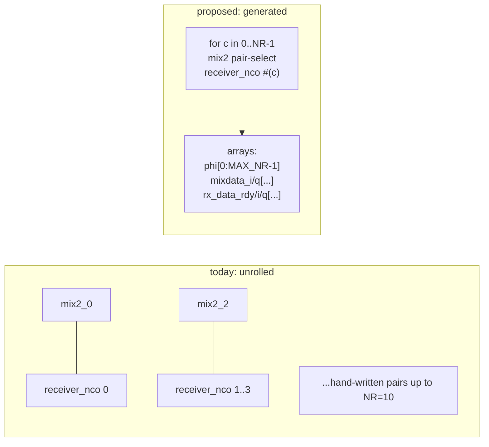
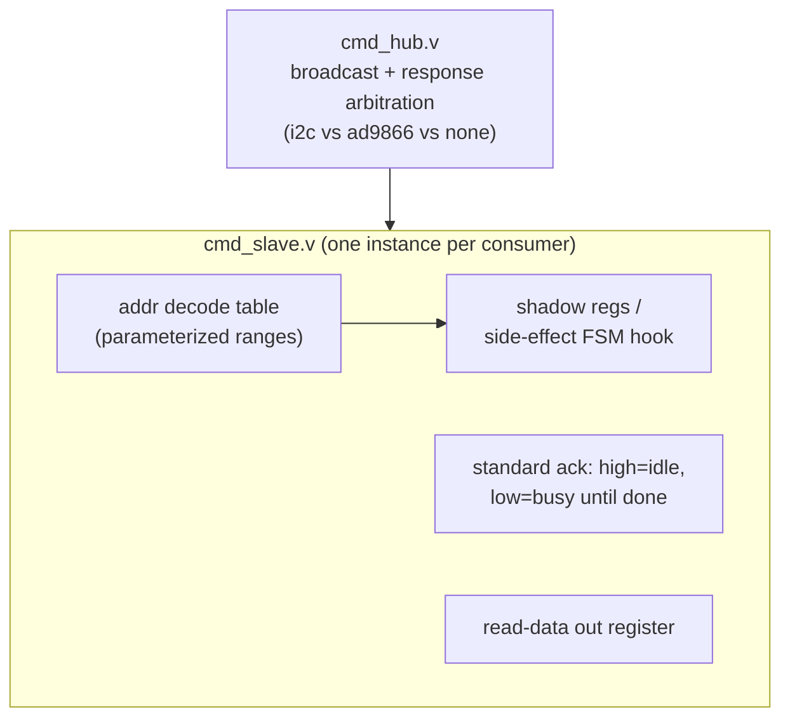
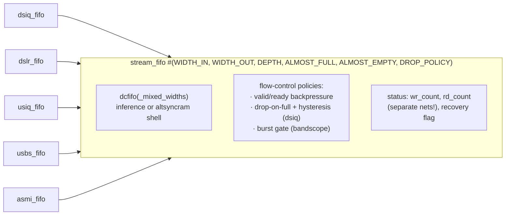

# Refactor Plan for the Hermes-Lite 2 Gateware

Five refactors chosen to improve clarity and conciseness of the RTL **without
inflating FPGA resources** on the EP4CE22 (see [Architecture](Architecture) for the
current structure and [Critical Bugs](Critical-Bugs) for motivation where noted).
They are ordered so that earlier items reduce the risk of later ones; each is
independently shippable and verifiable against the existing MyHDL benches in
`gateware/sim/`.

| # | Refactor | Primary payoff | Resource risk |
|---|----------|----------------|---------------|
| R1 | Generate-based receiver array — **DONE** (`radio.v` MIXPAIR/RXCHAIN loops; preserves the {0,2}/{1,3} pairing, VNA phase/reset specials, PureSignal mux, NR=2..4 extra mixer pair, per-channel `REGISTER_OUTPUT`, ch0 debug/VNA taps; DSP constraint paths updated) | −~150 lines in `radio.v`, kills copy-paste channel bugs | None (netlist-equivalent) |
| R2 | Unified command/response bus — **DONE** (`cmd_bus.vh` single address map + contract + responder table included by all 10 consumers; `cmd_slave.v` capture helper adopted in dsopenhpsdr1; RESP arbiter read-data path made honest; all raw hex decodes replaced by symbols) | One address map & ack contract instead of 7 ad-hoc copies | None |
| R3 | Common async-FIFO/AXI-Stream wrapper library — **DONE** (shared `stream_fifo` shell in `fifos.v`; `usiq_fifo` Bug 5 fixed; `icmp_fifo` migrated; no build-list changes needed) | Fixes Bug 5 class, removes 6 divergent wrappers | Slightly fewer M9K status bits |
| R4 | CDC toolkit consolidation — **DONE** (`sync.v`: guards + `sync_qualifier` + proper `sync_handshake`; DHCP toggle handshake; `remote_ip` capture fix; CW keyer qualified capture; `QUASI_STATIC_CDC` annotations) | Makes every crossing explicit; fixes Bug 3 class | None (preserve attributes kept) |
| R5 | Build/variant hygiene + single source of clock constants — **DONE** (commit "R5 build hygiene") | Faster compiles, honest file list, no `CLK_FREQ` ternary chains | None (dead code pruned) |

Implementation note for R3: to avoid touching a dozen board/variant file
lists, the shared core lives in `rtl/fifos.v` itself rather than a new
`fifos_lib.v` as originally sketched. The optional Icarus-friendly
behavioral inference fallback was deferred: all wrappers still use the
Altera megafunction cells behind the shell.

---

## R1 — Replace the hand-unrolled receiver ladder with a generate loop

**Problem.** `radio.v:508-703` contains ten nearly identical `if (NR >= k)` blocks
(`MIX1_3`, `RECEIVER1`…`RECEIVER9`) plus three hard-coded channel→NCO-index mapping
case statements (`radio.v:324-377`) that must be manually kept consistent with each
other and with `last_chan`. `receiver.v` and `receiver_nco.v` are ~90% duplicates of
each other; `mix2_0`'s special cases (VNA input, PureSignal DAC tap, RX-follows-TX)
are welded into the unrolled code.

**Proposal.**



* Introduce `localparam MAX_NR = 10;` sized arrays once (`rx_phase`,
  `rx_data_i/q`, `rx_data_rdy`, `adcpipe`) and instantiate channels in one
  `generate for (c = 0; c < NR; c++)` block.
* Express per-channel exceptions as data, not structure:
  * ADC source select: `adc_src[c] = (pure_signal && c==1) ? tx_data_dac : adcpipe[pair(c)]`
    (keeps the existing pairing of two receivers per mixer).
  * VNA substitution stays as the existing mux on `rx_data_rdy[0]`.
  * RX-follows-TX logic for channel 0 becomes an indexed write into `rx_phase[0]`.
* Derive `nco_index` arithmetically from `cmd_addr[4:0]` and the link mode instead
  of three case tables; keep the tables only if testing shows ambiguity.
* Retire `receiver.v` from the build after porting its one unique feature (the
  internal CORDIC front end, unused by HL2) into a comment/reference, leaving
  `receiver_nco.v` as *the* receive chain.
* Fold the `REGISTER_OUTPUT(HL2LINK)` parameter into a single conditional.

**Resource impact:** none by construction — same instances, same parameters; the
generate loop elaborates to the identical netlist for `NR=4`. The unused
`firfilt` write-enable outputs (`weE–weH`, `firfilt.v:147-156`) can be pruned at
the same time.

**Validation:** `test_rx1.py`, `test_rx2.py`, `test_rx2IQ.py` (CIC/varcic/FIR
chain), then a full-frame sim comparing upstream packets before/after refactor;
finally bitfile A/B on hardware with a known signal.

---

## R2 — Consolidate the command/response bus into one reusable component

**Problem.** The `cmd_addr/cmd_data/cmd_rqst/cmd_ack` protocol is re-implemented
with slightly different conventions in seven places: `radio.v:220-313` (multi-cycle
FREQ states), `ad9866.v:130-142`, `ad9866ctrl.v:110-204`, `i2c_bus2.v`,
`usopenhpsdr1.v:132-151`, `dsopenhpsdr1.v:391-402`, `control.v:209-220`. Each
re-invents address decoding, ack polarity ("ack low while busy" vs "ack pulse"),
and response capture — which is exactly how Bug 4a (wrong read-back muxing)
happened, and why the CDC contract ("data stable before strobe") lives only in
comments.

**Proposal.**



* `cmd_slave.v`: takes `(clk, cmd_addr, cmd_data, cmd_rqst)`, exposes a decoded
  `sel` plus optional `busy/done` handshake and a registered read port. Write-only
  slaves just get `sel` + data; multi-cycle slaves (frequency pipeline in
  `radio.v`) keep their internal FSM but hang off the standard strobe.
* `cmd_hub.v` in `control.v` replaces the RESP FSM's fragile dual-ack test with
  explicit arbitration: exactly one slave may be busy; responses are captured from
  the slave that owns the address (directly fixing Critical-Bug 4a).
* Document the crossing contract once, in the hub header: *"cmd_data must be
  registered in the source domain ≥2 destination-clock cycles before cmd_rqst
  arrives; commands are spaced ≫ sync latency."*
* Address map moves to one `` `include ``d localparam list shared by hub and slaves,
  ending the six-way duplication of hex codes like `6'h39`.

**Resource impact:** neutral. Decoders already exist per-slave; centralizing them
removes duplicated comparators in some slaves (a few LEs saved). No new registers
beyond the existing shadow/response registers.

**Validation:** `test_i2c_bus2.py`; add a small bench that walks every address in
the map and asserts expected ack/read behaviour; hardware regression via host
software (Thetis/pihpsdr) discovery + control round-trip.

---

## R3 — One async-FIFO/streaming wrapper library

**Problem.** `fifos.v` contains four hand-rolled wrappers (`dsiq_fifo`,
`dslr_fifo`, `usiq_fifo`, `usbs_fifo`) around Altera megafunctions, each with
different flow-control idioms: `allow_push` hysteresis, `wrusedw` thresholds, a
burst-gate state machine, showahead assumptions — and one outright defect (Critical
Bug 5: `wr_tlength` driven by both `wrusedw` and `rdusedw`). `asmi_fifo` and
`icmp_fifo.v` add two more styles. Every new stream means re-learning bespoke
semantics, and the mixed-width FIFOs silently depend on Quartus-specific
`dcfifo_mixed_widths`.

**Proposal.** Create `rtl/fifos_lib.v` (or a SystemVerilog package + module):



* Single implementation with **separate** `wr_count`/`rd_count` outputs (Bug 5
  becomes structurally impossible), consistent AXI-Stream-style ports
  (`tvalid/tready/tlast/tuser`), and pluggable drop policy.
* Keep the Altera megafunction behind the wrapper; optionally infer simple dual-port
  RAM for the non-mixed-width cases so the library also simulates cleanly under
  Icarus (the current wrappers require Altera cells).
* Move the ICMP echo byte-FIFO under the same roof.

**Resource impact:** M9K counts unchanged (same depths); a few LEs saved by deleting
per-wrapper status plumbing. Mixed-width packing (9b→36b) stays as-is since it is
what makes the TX path cheap.

**Validation:** functional equivalence benches driving each old/new pair with the
same stimulus (occupancy traces compared); then the full RX/TX loopback sim.

---

## R4 — Make the CDC layer explicit and fix its broken members

**Problem.** Crossings are scattered and self-documented at best: `sync`,
`sync_pulse`, `sync_one` are sound but have no guards (`DEPTH<2` silently breaks);
`sync_handshake` is broken (single-flop crossing, `sync.v:98-103`) yet ships in the
tree; several buses cross raw because they are "quasi-static" (command words,
`cw_openhpsdr` keyer parameters, `local_mac` jumper pin), and two real violations
exist in DHCP/ARP (Critical Bug 3).

**Proposal.**

1. Rewrite `sync.v` as the single CDC toolkit:
   * `sync #(DEPTH=2)` — level synchronizer (add initial-value + elaboration check
     `if (DEPTH < 2) $error`).
   * `sync_pulse`, `sync_one` — unchanged semantics, guarded.
   * `sync_qualifier`: multi-bit bus + synced valid toggle (the pattern used for
     `remote_mac`), replacing raw-bus captures.
   * Delete or correctly implement `sync_handshake` (proper req/ack with
     destination-domain synchronizer and return-path toggle).
   * Add `gray_counter`/`async_status` helpers if occupancy reporting ever leaves
     the dcfifo primitives.
2. Migrate offenders:
   * `dhcp.v:234` clear-side → toggle handshake (set side already correct).
   * `network.v:704` → use the existing synced valid pulse like line 700 does.
   * `cw_openhpsdr.v:75-91` → wrap keyer parameters with `sync_qualifier` toggles
     (or latch them only when the keyer is idle).
   * `hermeslite_core.v:444` MAC-from-jumper → sample `io_alternate_mac` through a
     `sync` and qualify the MAC update.
3. Annotate every remaining raw crossing with a one-line comment tag
   (`// QUASI_STATIC_CDC: reason`) so future greps find them all — there are ~20.

**Resource impact:** a handful of flops added at migrated sites; all synchronizers
already carry `(*preserve*)` so timing behaviour is unchanged.

**Validation:** static review pass listing every crossing vs the new taxonomy;
DHCP renewal bench (short lease, server up/down cycles); keyer live-speed-change
test on hardware.

---

## R5 — Build hygiene: prune dead RTL and derive clock constants programmatically

**Problem A — the compile list lies.** `boards/hl2b5up/files.tcl` lists
`firfilt.v`, `CicInterpM5.v` etc. **twice**, pulls the entire QS1R receiver
subtree, `receiver.v`, `receiver_ciconly.v`, `receiver_4000.v`, and both
`radioberry` forks of `control/ad9866ctrl/ad9866pll` even though nothing instantiates
them for this variant. Elaboration cost and reader confusion grow; grep results lie;
the radioberry duplicates invite editing the wrong file.

**Problem B — clock-rate magic.** `radio.v:86-99` encodes support for four clock
rates as chained `(CLK_FREQ == …) ? … : …` ternaries over five localparams
(`M2`, `CICRATE`, `GBITS`, `RRRR`, `RATE48`). Adding a rate means editing five
expressions coherently, with silent-wraparound hazards if a value is missed.

**Proposal.**

1. Split the source list per subsystem (`files_core.tcl`, `files_ethernet.tcl`,
   `files_radio_hl2.tcl`, …) and let variants include what they use; delete
   duplicates; move QS1R/radioberry trees out of the default include set (keep the
   files in-repo for their boards' own variants).
2. New `rtl/clk_config.vh` (macro/localparam package) computing, from `CLK_FREQ`
   alone:
   ```verilog
   // phase increment constant: round(2^57 / CLK_FREQ)
   localparam [31:0] M2      = PHASE_CONST_57;
   localparam        CICRATE = CLOG2-scaled decimation pick…;
   localparam        RATE48  = CLK_FREQ / (CICRATE * 8 * 48000);
   ```
   with `$error` guards for unsupported rates. `radio.v`, `vna_scanner.v` and the
   testbenches (which duplicate the same ternaries, e.g. `test_rx2.py`'s
   `VAR_ACC_WIDTH`) consume it.
3. While touching the tree: delete the commented-out CWX/EER dead code blocks in
   `radio.v:1098-1124`, remove the vestigial `rst_channels` unconnected port
   (`hermeslite_core.v` radio instance) or wire it, and quarantine
   `cdc_sync.v`'s inert simulation model.

**Resource impact:** strictly negative — smaller elaboration set, zero netlist
change for instantiated logic.

**Validation:** compile-time only (Quartus resource summary diff should show
identical LE/M9K/DSP totals for `hl2b5up_main`); run one MyHDL bench to confirm
constants resolve identically.

---

## Suggested landing order and effort

| Order | Item | Est. effort | Why here |
|-------|------|-------------|----------|
| 1 | R5 hygiene | 0.5 day | Shrinks everything else you have to read |
| 2 | R3 FIFO library | 2 days | Removes the Bug-5 defect before other work depends on FIFO behaviour |
| 3 | R4 CDC toolkit | 1–2 days | Fixes Bug 3; establishes rules used by R1/R2 refactors |
| 4 | R1 receiver generate loop | 2–3 days (incl. A/B hardware test) | Biggest clarity win; benefits from stable FIFO/CDC infra |
| 5 | R2 command bus | 3 days | Touches the most modules; do last, with R4's contracts in place |

Each step keeps the EP4CE22 fit unchanged; the acceptance bar for all five is
*bit-comparable behaviour* verified first by the MyHDL benches, then by a
packet-capture diff of upstream traffic before/after, and finally an on-air
regression (RX noise floor, CW keying scope shot, PureSignal run).
