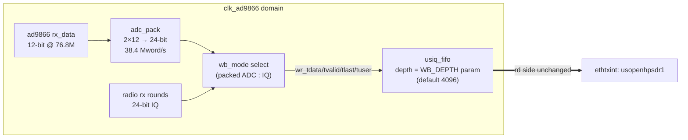
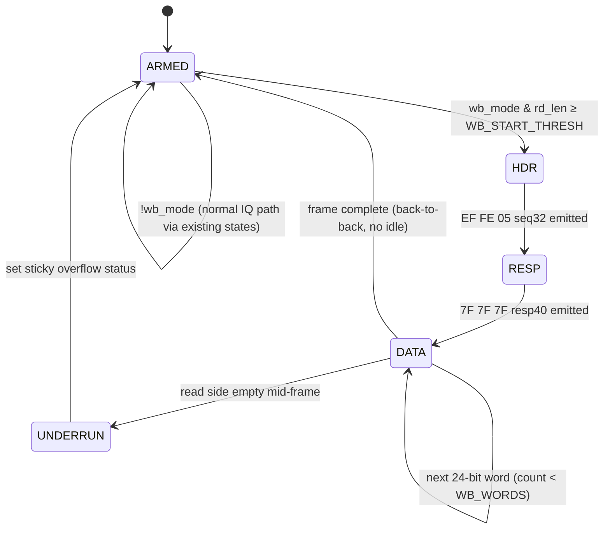

# Plan: Full-Rate Wideband ADC Streaming over Gigabit Ethernet

Status: **proposal / implementation plan** (not yet implemented)

Today the wideband ("bandscope") path delivers only a sliver of the AD9866 ADC
output: 12-bit samples trickle through `usbs_fifo` and are emitted as occasional
`ep4` packets. The ADC itself produces far more data than that — and almost
exactly what a dedicated gigabit link can carry:

| Quantity | Value |
|---|---|
| ADC sample rate | 76.8 MS/s |
| ADC width | 12 bit |
| Raw ADC data rate | **921.6 Mbit/s** |
| Gigabit line rate | 1000 Mbit/s |

This plan describes how to stream **every ADC sample** to the host, removing the
legacy wideband path to pay for it. It follows existing design patterns
throughout: broadcast command decoding (à la the VNA bit), the shared-FIFO +
threshold-start pacing of the SDR data path, and the existing UDP frame
skeleton.

---

## 1. Bandwidth Analysis (why jumbo frames)

A UDP frame of payload `L` bytes consumes `L + 38` wire bytes (8 preamble +
14 MAC + 4 FCS + 12 IFG). Our frames carry 12 bytes of non-sample payload (7-byte
header `EF FE <ep> <seq32>` + 5-byte response tail `7F 7F 7F <resp[39:0]>`) plus
28 bytes of IP+UDP headers, so the achievable *sample* bitrate is:

```
sample_bw = 1000 Mbit/s × L/(L+38) × (L−40)/L
```

| UDP payload L | Wire efficiency | Sample bandwidth | Margin vs 921.6 |
|---|---|---|---|
| 1032 (current frames) | 96.4 % | 927 Mbit/s | **+0.6 % — unusable** |
| ~4500 (mid jumbo) | 99.2 % | 983 Mbit/s | +6.7 % |
| 8972 (classic jumbo) | 99.6 % | **991 Mbit/s** | **+7.6 % — target** |

Standard frames fit *on paper* with under 1 % margin; any host hiccup makes that
a drop machine. **Jumbo frames (8972-byte UDP payload) are the design point**,
giving ~7.6 % headroom and cutting the packet rate from ~116 kpps to ~10.3 kpps,
which is what makes sustained kernel capture realistic even on a dedicated port.

Per-frame overhead added by our own 12 bytes is only 0.13 % at jumbo sizes.

---

## 2. What Gets Removed

Removing the legacy wideband path funds most of the new logic:

| Item | File(s) | Reclaimed |
|---|---|---|
| `usbs_fifo` instance + module | `hermeslite_core.v`, `fifos.v` | ~3 M9K |
| `WIDE1..WIDE4` builder states, `bs_cnt`, `set_bs_cnt`, `ep4_seq_no`, `bs_*` ports | `usopenhpsdr1.v` | LEs |
| Bandscope advertisement `{BANDSCOPE_BITS, …}` in discovery | `usopenhpsdr1.v` | — (repurposed, see §4) |
| Legacy `wide_spectrum` flag plumbing | `dsopenhpsdr1.v` RUNSTOP bit 1, `hermeslite_core.v` syncs | LEs |

**Caution — watchdog migration:** `watchdog_up` (which feeds the PC-liveness
watchdog in `dsopenhpsdr1`) currently toggles in `usopenhpsdr1.START` on
bandscope FIFO activity. When `usbs_fifo` disappears this must be rewired to
toggle once per completed SDR/ADC frame instead — same external semantics (host
is receiving frames), different trigger. Call this out in review; losing it
silently kills the run-watchdog.

---

## 3. Mode Entry (existing command-bus pattern)

Follow the VNA precedent: a single command address decoded independently by each
interested slave in its own domain.

* Add `CMDA_WIDEBAND = 6'h18` to `rtl/cmd_bus.vh` (slot currently unused;
  `cmd_data[0]` = wideband-enable, remaining bits reserved).
* Consumers:
  * `hermeslite_core.v` (clk_ad9866 domain) — FIFO input mux select (§5).
  * `usopenhpsdr1.v` (ethtxint domain) — builder mode select (§6).
  * `radio.v` — optional: gate narrowband `rx_tvalid` when wideband is active
    (defensive; see §5 note on mutual exclusion).
* Quasi-static configuration, applied between packets — identical to how
  `CMDA_VNA_TXGAIN` is consumed by three domains today. No CDC work needed
  beyond the existing synced `cmd_rqst` pulse.

**Mutual exclusion by construction:** the plan reuses `usiq_fifo` as the single
upstream sample FIFO, so wideband mode *replaces* narrowband IQ streaming for
its duration (the host stops receiving 48 kHz receivers while streaming ADC).
This is stated explicitly because it drives the packet format and host
expectations.

---

## 4. Discovery Advertisement

Repurpose the retired bandscope nibble in the discovery packet
(`{BANDSCOPE_BITS, BOARD[5:0]}`) as a wideband-capability nibble (e.g. `4'b0001`
= "full-rate ADC streaming, 24-bit packed"). Protocol-visible change: legacy
hosts reading the BOARD nibble are unaffected; wideband-aware hosts get their
feature-detect for free. Coordinate the value with host software before merging.

---

## 5. Datapath Changes

### 5.1 ADC packer (new, tiny)

New `adc_pack.v` in the clk_ad9866 domain (glue lives beside the FIFO
instantiation in `hermeslite_core.v`, matching existing style):

* Collects consecutive `rx_data[11:0]` pairs into one 24-bit word
  (`{sample_n, sample_n+1}`), emitting at 38.4 Mword/s.
* A toggle flop selects high/low half; reset (`rst_all` and wideband-off)
  clears it so pairs never straddle a mode change.
* `tuser = 0`, `tlast = 0` for this stream (builder is count-driven, not
  frame-driven).

### 5.2 FIFO reuse and mode mux

`usiq_fifo` stays exactly where it is; only its *write side* is multiplexed in
the clk_ad9866 domain:



* Both sources are already in the clk_ad9866 domain — **no new CDC**.
* `usiq_fifo` gains a `DEPTH` parameter (currently hardcoded 1024); everything
  else about the wrapper (near-full backpressure, `rd_tlength`) is unchanged.
* Recommended depths (27-bit words):

| Depth | ~M9K | Stall tolerance (÷38.4 Mword/s) |
|---|---|---|
| 1024 (today) | 4 | 27 µs |
| 2048 | 7 | 53 µs |
| **4096 (default)** | **14** | **107 µs** |
| 8192 | 27 | 213 µs |

  The FIFO only has to absorb inter-packet gaps and short host stalls —
  **not** whole packets (explicitly out of scope). A 107 µs tolerance covers
  normal interrupt/NAPI jitter on a dedicated, unshared link; longer stalls
  cause drops that are *reported*, not hidden (§7).

* Backpressure policy: keep the existing `wr_occ > 1012` near-full gate shape,
  scaled to the new depth (parameterize as `ALMOST_FULL`).

### 5.3 Pacing (existing threshold pattern)

Exactly like today's `us_tlength > 333` rule: the builder arms when
`rd_tlength ≥ WB_START_THRESH` (new parameter, e.g. 256 words) so the first
frame has runway, then emits frames **back-to-back** — never returning to idle
while data keeps arriving. Underrun (read side empties mid-frame) aborts the
frame, returns to the armed state, and sets a sticky status bit.

---

## 6. Packet Format

Skeleton identical to SDR IQ frames; only the RXDATA section differs:

| Offset | Size | Content |
|---|---|---|
| 0 | 7 | `EF FE <ep> <seq[31:24]> <seq[23:16]> <seq[15:8]> <seq[7:0]>` |
| 7…L−6 | variable | **packed ADC words**, 3 bytes each, big-endian: word = `{sample_2n[11:0], sample_2n+1[11:0]}` |
| L−5 | 5 | response tail `7F 7F 7F <resp[39:0]>` — same C&C reply slots as IQ frames |

* **MIC bytes removed** (they were appended after the receiver rounds); **no
  padding anywhere** — the frame length is chosen so `(L − 12)` divides exactly
  by 3.
* Endpoint byte: legacy bandscope used `04`, SDR IQ uses `06`. Propose **`05`
  = full-rate ADC stream** so hosts can distinguish all three frame types by
  the endpoint alone (coordinate with host software).
* Frame sizing example targeting the classic-jumbo class: `L = 8970` (just
  under the 8972 reference above, chosen so `(L − 12)` divides by 3); data
  words = (8970−12)/3 = **2986** words = **5972 ADC samples** per frame, wire frame
  9008 bytes ≤ the 9022 jumbo ceiling. Final numbers are build-time
  localparams derived from one `WB_PAYLOAD` parameter.
* Sequence numbering continues the existing `ep6_seq_no`-style free-running
  counter; hosts detect loss by gaps, corroborated by the sticky overflow bit.

Where does the sticky overflow/recovery status go? Reuse the proven
`dsiq_status` pattern: a bit captured FIFO-recovery-style, exposed in the
discovery packet fields (and/or a reserved `resp_control` bit) so the host can
quantify loss without a second control channel.

---

## 7. Builder FSM Changes (`usopenhpsdr1.v`)



* The existing `START/UDP1/UDP2/SYNC_RESP/RXDATA*` states remain for narrowband
  IQ; wideband adds a parallel arm selected by `CMDA_WIDEBAND` bit 0, sharing
  the `udp_tx_request`/`udp_tx_enable` handshake and the `SYNC_RESP` emission
  code verbatim.
* `udp_tx_length` widens from `[10:0]` to `[13:0]` (jumbo lengths exceed 2047);
  audit `ip_send`/`mac_send`/`rgmii_send` counter widths in the same pass
  (§8).

---

## 8. Ethernet/Jumbo Work Items

| Area | Change |
|---|---|
| `usopenhpsdr1` | `udp_tx_length` width; WB frame constants |
| `network.v` | nothing structural — `dhcp_udp_tx_length` is already 16-bit; confirm `tx_is_udp1` routing unused-by-WB (WB uses the plain UDP0/port-1024 destination learned from the host, same as IQ frames) |
| `udp_send.v` | length passthrough widths; fix the missing `byte_no` reset while there (Critical Bugs honorable mention) |
| `ip_send.v` | total-length/checksum arithmetic is 16-bit — OK for ≤9022; verify no hardcoded 1500 assumptions |
| `mac_send.v` | padding/FCS tail logic: verify byte counters tolerate >1522-byte frames (pad path must stay inert) |
| `rgmii_send.v` | purge/IFG counter widths |
| `timing.sdc` | no change expected; recheck 125 MHz paths through widened counters |

---

## 9. Resource Budget and the NR=4 → NR=2 Fallback

EP4CE22 budget sketch (M9K, ±packing variance):

| Block | Today | After WB (NR=4) | After WB (NR=2) |
|---|---|---|---|
| `usiq_fifo` (27b) | ~4 (×1024) | ~14 (×4096) | ~14 (×4096) or ~27 (×8192) |
| `usbs_fifo` | ~3 | **−3** (removed) | −3 |
| FIR coefficient/sample RAMs | ~20 (4 ch) | ~20 | **~10 (2 ch)** |
| NCO coarse/fine ROMs | ~4 | ~4 (shared, unchanged) | unchanged |
| Misc (asmi/icmp/dsiq/dslr…) | rest | unchanged | unchanged |

* **First attempt: keep NR=4** with `WB_DEPTH=4096`. Expected net M9K delta
  ≈ +7 over today — likely fits, since the removed `usbs_fifo` and wideband
  glue offset part of it and today's build has slack.
* **Fallback: `NR=2`** (receivers 0/1 kept — PureSignal on channel 1 survives,
  and `MIXPAIR[1]` is still built at NR=2 exactly as the generate loop encodes
  today). Frees ~10 M9K plus 16 DSP multipliers and substantial LEs, making
  `WB_DEPTH=8192` affordable if host-stall tolerance proves insufficient.
* LE cost of the new logic itself is small: `adc_pack` (~30 LE), builder arm
  (~100–200 LE), muxes (~50 LE).

---

## 10. Host Requirements

* Dedicated, unshared NIC + direct cable (given): disables PAUSE-frame and
  switch-queue surprises; note the FPGA implements **no flow control**, so the
  only loss signal is the sticky status bit plus sequence gaps.
* NIC MTU ≥ 9014; disable coalescing features that add latency spikes
  (at ~10 kpps even a modest ring keeps up; verify with coalescing defaults first).
* Capture path sized for a sustained ~112 MB/s (AF_PACKET/PF_RING/DPDK-style
  ring); sequence-gap accounting from the 32-bit frame counter.
* Mode transition protocol: send `CMDA_WIDEBAND` bit0=1 via the normal C&C
  slot; host switches its frame parser on endpoint `05`; reverse to exit.
* During wideband mode the host must **not** expect 48 kHz receiver packets
  (mutual exclusion, §3).

---

## 11. Implementation Order

1. **Removal pass**: delete `usbs_fifo`/wideband states; rewire `watchdog_up`;
   repurpose discovery nibble. Build + regress narrowband — this must be a
   no-op for existing operation.
2. **FIFO parameterization + mux + `adc_pack`** with `CMDA_WIDEBAND` decode;
   wideband builder states behind the mode bit; jumbo width widening.
3. **Simulate** (MyHDL bench in `gateware/sim/`, following `test_rx*.py`
   style): feed a synthetic ADC ramp through packer → FIFO → builder; assert
   received payload words equal the injected sample sequence, frame sizes match
   `WB_PAYLOAD` arithmetic, underrun/overflow status behaves.
4. **Hardware bring-up**: jumbo ping flood → iperf-style saturation test from
   FPGA frames; tcpdump validation of frame layout; measure drop behavior under
   deliberate host stall; verify narrowband regression and PureSignal still
   functional.
5. Decide `NR` / `WB_DEPTH` combination from resource report and stall testing.

---

## 12. Risks and Open Questions

* **Endpoint byte value (`05`)** and the discovery-nibble encoding need host
  sign-off before merge.
* **Sustained host capture at 922 Mbit/s** is the long pole even on a dedicated
  port; if the host cannot keep up, drops surface via the status bit — by
  design, but expectations must be set.
* FIFO stall tolerance is finite (~107 µs at the default depth): occasional
  frame loss under long host stalls is normal operation, not a bug; document
  for users.
* `mac_send`'s intricate CRC-tail byte accounting (see Critical Bugs) has only
  been exercised at ≤1522 bytes — bench-test jumbo FCS correctness early
  (step 4).
* AK4951 builds: wideband mode is undefined for them (tuser width differs);
  gate `CMDA_WIDEBAND` decode with the `AK4951` parameter.
